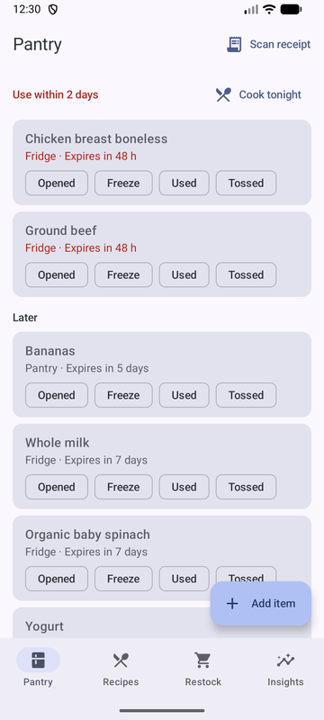
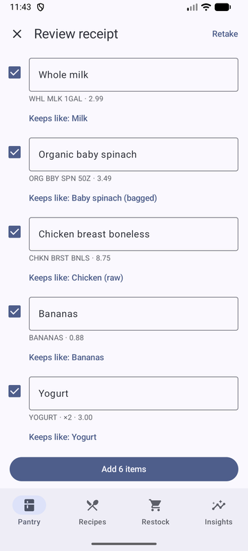
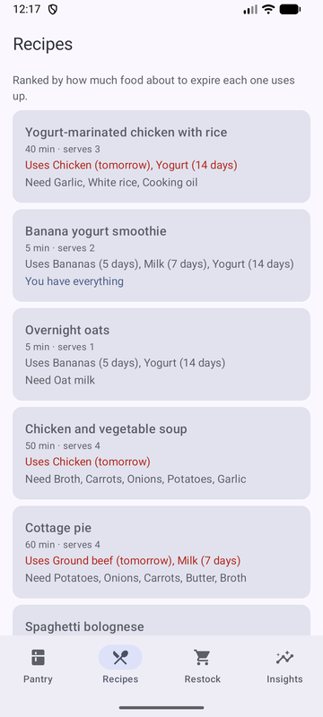
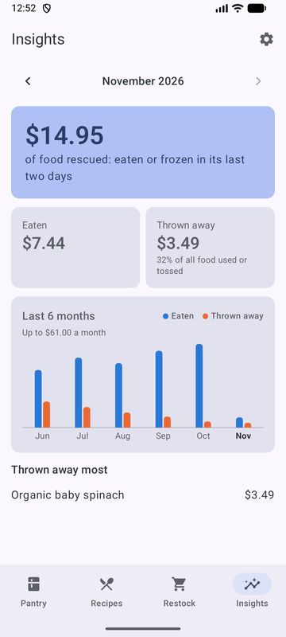
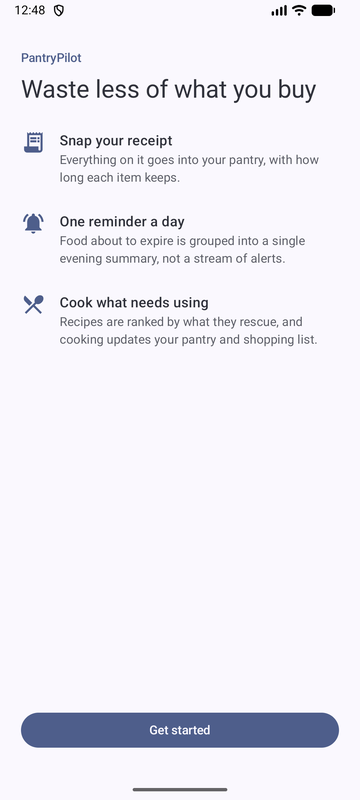
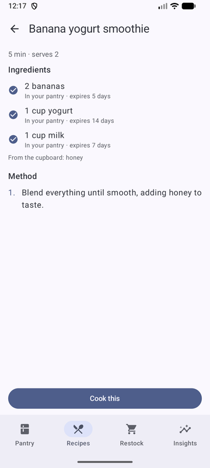
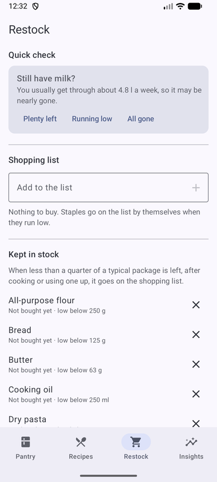

# PantryPilot

An Android app that cuts household food waste. Snap a grocery receipt and everything on it goes into your pantry with a shelf-life countdown. The app then tells you once a day what to use first, ranks recipes by how much food they rescue, and keeps the shopping list topped up by itself.

Most pantry trackers are abandoned within weeks because nobody wants to type in thirty expiry dates or log every splash of milk. PantryPilot is built around removing that typing.

<p>
  
  
  
  
</p>

## Features

- **Receipt scanning.** On-device OCR reads a receipt photo. Till shorthand such as `ORG BBY SPN 5OZ` becomes "Organic baby spinach", with its size, price and shelf-life rule. You review everything before it's added, and your corrections are remembered for that store's shorthand.
- **Barcode scanning.** Product names and package sizes come from Open Food Facts and are cached, so a product you've scanned before is filled in with no network call.
- **Shelf life that tracks what you do.** Each food has storage rules for pantry, fridge and freezer. Opening a carton of broth shortens its countdown from months to days. Freezing chicken pauses its countdown, and thawing it resumes where it left off.
- **One reminder a day.** An evening summary groups everything expiring in the next 48 hours, with "Find a recipe" and "Freeze all" actions, instead of one alert per item.
- **Recipes that rescue food.** 24 bundled recipes are ranked by the value of the expiring food they use. Cooking one deducts exact amounts from your pantry, soonest-expiring first.
- **A shopping list that fills itself.** Staples go on the list when they drop below a quarter of a package. For staples you buy often, usage is estimated from how often you buy them, followed by a one-tap "Still have milk?" check instead of logging every use.
- **Waste and savings dashboard.** Shows each month's value of food eaten, rescued in its last two days and thrown away, with a six-month trend.

<p>
  
  
  
</p>

## Engineering highlights

### Event-sourced shelf-life engine
An item's expiry is never edited directly. It is recomputed by replaying the item's events (stored in a zone, opened, moved) through [`DecayEngine`](domain/src/main/kotlin/com/pantrypilot/domain/decay/DecayEngine.kt):
- Outside the freezer, an item keeps the *fraction* of shelf life it has left, so moving bread from pantry to fridge rescales its countdown.
- Opening converts the time left into the opened shelf life, so it can shorten the countdown but never extend it.
- The freezer pauses that fraction and runs its own clock. Thawing in time resumes the paused countdown; thawing too late doesn't revive the food.

### Receipt normalization pipeline
OCR returns names and prices as separate pieces of text. [`ReceiptLayout`](domain/src/main/kotlin/com/pantrypilot/domain/receipt/ReceiptParser.kt) rebuilds rows by baseline. [`ReceiptParser`](domain/src/main/kotlin/com/pantrypilot/domain/receipt/ReceiptParser.kt) then handles:
- quantity lines (`2 @ 1.50`)
- weighed produce whose name sits on the row above its price
- discounts, tax letters and comma decimals
- stopping at the total

[`ReceiptNormalizer`](domain/src/main/kotlin/com/pantrypilot/domain/receipt/ReceiptNormalizer.kt) expands abbreviations, then matches what's left against food names by prefix and by dropped vowels (`SPN` → spinach, `BRST` → breast). Package sizes are parsed too, including OCR's habit of reading `5OZ` as `50Z`.

### Unit conversion through a density table
Packaging says 1 kg of flour; recipes say 2 cups. [`UnitConverter`](domain/src/main/kotlin/com/pantrypilot/domain/quantity/Units.kt) converts within a dimension exactly. Across dimensions it goes through weight, using each food's grams per millilitre and grams per piece. A seed-data test checks that every recipe line converts to the unit its food is stocked in.

### Recipe scoring
[`RecipeScorer`](domain/src/main/kotlin/com/pantrypilot/domain/recipe/RecipeScorer.kt) ranks recipes by

```
score = Σ (urgency × value of the amount used) − penalty × Σ shortfall
```

- **Urgency** halves for every two days of shelf life left, so $9 of chicken expiring tomorrow outweighs rice that keeps for a year.
- **Ingredients are drawn** from the soonest-expiring package first, and expired food is never used. Cooking deducts in the same order.
- **The penalty is $1** per missing ingredient, scaled by how much is missing. At $2, emulator testing showed a smoothie of long-dated yogurt outranking chicken that expired the next day. A regression test now covers that case.

### Scheduled digest without polling
[`DigestPlanner`](domain/src/main/kotlin/com/pantrypilot/domain/digest/DigestPlanner.kt) and [`DigestWorker`](app/src/main/kotlin/com/pantrypilot/app/digest/DigestWorker.kt):
- **One run a day**: a single delayed WorkManager job at the user's chosen local time, chained from one day to the next. It is worked out in the device's time zone, so it survives daylight saving changes and travel; a clock or time-zone change reschedules it.
- **At most one notification a day**: each run is logged under its local date before notifying, so a retried job can't send twice.
- **No repeats**: a digest is only sent when something is new since the last one.

### Depletion estimated from purchases
[`DepletionEstimator`](domain/src/main/kotlin/com/pantrypilot/domain/depletion/DepletionEstimator.kt) estimates daily use from purchase intervals: everything bought before the latest purchase, spread over the time it covers. When the records say there's enough but the estimate says it has probably run low, the app asks one question, and the answer resets the estimate.

## Architecture

```
:domain   Pure Kotlin, no Android. All the logic above, unit-tested on the JVM.
:data     Room database, repositories, Open Food Facts client, bundled seed data.
:app      Jetpack Compose UI, CameraX + ML Kit scanning, WorkManager, notifications.
```

- **Local-first**: no account and no backend. Everything is stored on the device.
- **Stack**: Kotlin, Jetpack Compose with Material 3, Hilt, Room, WorkManager, CameraX, ML Kit (on-device text and barcode recognition), kotlinx.serialization.

## Building

Requires Android Studio with JDK 17 or later, and the Android SDK for API 37.

```bash
./gradlew :domain:test :data:testDebugUnitTest
```

```bash
./gradlew :app:assembleDebug
```

There are 64 unit tests, covering the decay engine, receipt parsing and normalization, unit conversion, recipe scoring, digest timing, depletion estimates, the waste ledger, and the consistency of the bundled data.

## Data and limits

- **Shelf-life rules** in [`shelf_life_rules.json`](data/src/main/assets/shelf_life_rules.json) approximate common food-safety guidance. They are not a substitute for it.
- **Typical package prices and densities** are rough estimates, used only when a receipt gives no price or a recipe needs a conversion.
- **The receipt parser** is tuned to common US-style till receipts.
- **Recipes** are short everyday dishes written for the app.
